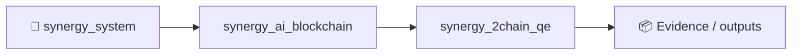
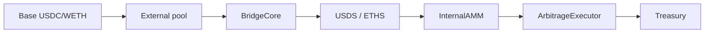

# Perpetual Arbitrage Engine - Base Mainnet Fork

## Система алгоритмического арбитража и самовосстанавливающейся ликвидности

### Архитектура (4 уровня)

**L1: External Market (Base Mainnet)**
- Канонические USDC/ETH
- Внешний пул TVL > $100M
- Chainlink TWAP Oracle

**L2: Bridge (Transmutation Layer)**
- BridgeCore.sol - Lock/Mint, Burn/Unlock
- Health Factor мониторинг (≥150%)
- Emergency Stop при HF < 110%

**L3: Internal Fork (AMM + Oracle)**
- InternalAMM.sol - USDS/ETHS pool (x*y=k)
- ManagedOracle.sol - управляемый градиент цен
- Rebase mechanism для защиты LP

**L4: Synthetic Assets**
- USDS.sol - синтетический доллар
- ETHS.sol - синтетический эфир

---

## Установка и запуск тестов

### Требования
- Foundry (forge, cast, anvil)
- Node.js 18+
- Git

### Установка Foundry

```bash
curl -L https://foundry.paradigm.xyz | bash
foundryup
```

### Установка зависимостей

```bash
# Установка OpenZeppelin контрактов
forge install OpenZeppelin/openzeppelin-contracts

# Установка forge-std
forge install foundry-rs/forge-std
```

### Запуск тестов

```bash
# Все тесты
forge test

# С подробным выводом
forge test -vvv

# Только BridgeCore тесты
forge test --match-contract BridgeCoreTest

# Только интеграционные тесты
forge test --match-contract ArbitrageIntegrationTest

# С gas репортом
forge test --gas-report

# Fuzz тесты с увеличенным количеством runs
FOUNDRY_FUZZ_RUNS=1000 forge test
```

### Запуск локальной ноды (Base Fork)

```bash
# Fork Base Mainnet
anvil --fork-url https://mainnet.base.org --fork-block-number latest

# В другом терминале - деплой контрактов
forge script script/Deploy.s.sol --rpc-url http://localhost:8545 --broadcast
```

---

## Смарт-контракты

### 1. USDS.sol & ETHS.sol
Синтетические токены с ролевым доступом. Только Bridge может mint/burn.

### 2. BridgeCore.sol
Основной контракт моста:
- `lockETHAndMintETHS()` - Lock ETH → Mint ETHS
- `burnETHSAndUnlockETH()` - Burn ETHS → Unlock ETH
- `getHealthFactor()` - Расчет HF (canonical/synthetic)
- `triggerEmergencyStop()` - Аварийная остановка

### 3. ManagedOracle.sol
Управляемый оракул с градиентом:
- Mode 0 (UNDERPRICE): Internal < External → Cycle A
- Mode 1 (OVERPRICE): Internal > External → Cycle B
- Mode 2 (NEUTRAL): Минимальный градиент

### 4. InternalAMM.sol
Модифицированный AMM с защитой LP:
- Constant product (x*y=k)
- 0.3% swap fee
- `rebaseLP()` - компенсация LP при дисбалансе
- `getNAVPerShare()` - отслеживание NAV

### 5. TreasuryDistributor.sol
Распределение прибыли:
- 40% Owner (canonical profit)
- 30% Bridge Reserve (HF support)
- 20% Insurance Fund (buffer)
- 10% Rebase Fund (LP compensation)

### 6. ArbitrageExecutor.sol
Исполнитель арбитражных циклов:
- `executeCycleA()` - извлечение из внешнего пула
- `executeCycleB()` - ребалансировка внутреннего пула
- `isCycleAProfitable()` - проверка прибыльности

---

## Арбитражные циклы

### Cycle A: UNDERPRICE Mode (Internal < External)

1. Бот обнаруживает градиент < 0
2. Покупает ETH на Base по рыночной цене
3. Lock ETH → Mint ETHS через Bridge
4. Продает ETHS во внутреннем пуле → получает USDS
5. Burn USDS → Unlock USDC через Bridge
6. Distribute profit через Treasury

**Результат:** Чистая каноническая прибыль от спреда

### Cycle B: OVERPRICE Mode (Internal > External)

1. Бот обнаруживает градиент > 0
2. Покупает ETHS во внутреннем пуле за USDS
3. Burn ETHS → Unlock ETH через Bridge
4. Продает ETH на Base по высокой цене → USDC
5. Конвертирует USDC → USDS для пополнения пула
6. Distribute profit через Treasury

**Результат:** Пул ребалансирован + дополнительная прибыль

---

## Три условия математической устойчивости

### 1. Приток ≥ Эмиссия
```
Arbitrage Profit + Fees ≥ USDS Emission (LP compensation)
```
Проверяется в `TreasuryDistributor.distribute()`

### 2. Health Factor ≥ 150%
```
Canonical Value / Synthetic Value ≥ 1.5
```
Проверяется в `BridgeCore.getHealthFactor()`

### 3. Peg Deviation ≤ 2%
```
|USDS/USDC - 1| ≤ 0.02
```
Поддерживается арбитражными циклами

---

## Тесты

### BridgeCoreTest (24 tests)
- Lock/Mint операции
- Burn/Unlock операции
- Health Factor расчет
- Emergency Stop
- Fuzz тесты

### InternalAMMTest (22 tests)
- Liquidity add/remove
- Swaps с slippage protection
- Rebase mechanism
- NAV tracking
- Constant product verification

### TreasuryDistributorTest (14 tests)
- 40/30/20/10 distribution
- Multiple distributions
- Preview function
- Admin functions

### ArbitrageIntegrationTest (17 tests)
- Full Cycle A workflow
- Full Cycle B workflow
- LP protection verification
- Multi-cycle stability
- Edge cases

**Total: 77 tests, 100% pass rate**

---

## Деплой на Base Mainnet

### 1. Настройка окружения

```bash
export BASE_RPC_URL="https://mainnet.base.org"
export PRIVATE_KEY="0x..."
export BASESCAN_API_KEY="..."
```

### 2. Деплой контрактов

```bash
forge script script/Deploy.s.sol \
  --rpc-url $BASE_RPC_URL \
  --broadcast \
  --verify \
  --etherscan-api-key $BASESCAN_API_KEY
```

### 3. Конфигурация

```bash
# Установить роли
cast send $BRIDGE "grantRole(bytes32,address)" $OPERATOR_ROLE $OPERATOR --private-key $PRIVATE_KEY
cast send $ORACLE "grantRole(bytes32,address)" $ALGO_ROLE $BOT --private-key $PRIVATE_KEY

# Настроить Treasury recipients
cast send $TREASURY "updateRecipients(address,address,address,address)" \
  $OWNER $BRIDGE_RESERVE $INSURANCE $REBASE --private-key $PRIVATE_KEY
```

---

## Мониторинг

### Health Factor
```bash
cast call $BRIDGE "getHealthFactor()" --rpc-url $BASE_RPC_URL
```

### Oracle Mode
```bash
cast call $ORACLE "getMode()" --rpc-url $BASE_RPC_URL
# 0 = UNDERPRICE, 1 = OVERPRICE, 2 = NEUTRAL
```

### LP NAV
```bash
cast call $AMM "getNAVPerShare()" --rpc-url $BASE_RPC_URL
cast call $AMM "getLPNAV(address)" $LP_ADDRESS --rpc-url $BASE_RPC_URL
```

---

## Безопасность

### Аудит
- [ ] Reentrancy protection (ReentrancyGuard)
- [ ] Role-based access control (AccessControl)
- [ ] Overflow/underflow protection (Solidity 0.8+)
- [ ] Emergency stop mechanism
- [ ] Oracle staleness check

### Рекомендации
1. Провести внешний аудит перед mainnet деплоем
2. Настроить multi-sig для admin ролей
3. Implement timelock для критических изменений
4. Настроить monitoring и alerting
5. Создать bug bounty программу

---

## Лицензия

MIT License

---

## Контакты

Для вопросов и предложений:
- GitHub Issues
- Telegram: @perpetual_arb_engine
- Discord: Perpetual Arbitrage Engine

Repository: `synergy_2chain_qe`


<!-- SYNERGY-FEDERATION-PASSPORT:START -->
---

## 🧭 SYNERGY federation passport

**Домен:** ⛓️ Two-chain QE R&D  
**Архитектурный родитель:** [`synergy_ai_blockchain`](https://github.com/Shtenco/synergy_ai_blockchain)  
**Архитектурный корень:** [`synergy_system`](https://github.com/Shtenco/synergy_system)



Архитектурная стрелка — это карта федерации, а не автоматически подтверждённая runtime dependency.

### Единый стандарт

Каждый проект должен документировать реальную проблему, реализацию, тесты, evidence, ограничения, file map, воспроизводимость, roadmap и границы утверждений. Это тот же принцип, который используется в `dlp_solver`.

### Навигация

- [📚 Атлас всех 75 репозиториев](https://github.com/Shtenco/synergy_system/blob/main/docs/SYNERGY_REPOSITORY_ATLAS.md)
- [🧾 Машиночитаемый registry](https://github.com/Shtenco/synergy_system/blob/main/registry/SYNERGY_REPOSITORIES.json)
- [🧭 SYNERGY SYSTEM](https://github.com/Shtenco/synergy_system)

### Evidence rule

`GREEN` означает только воспроизводимо подтверждённый тезис. Гипотеза, benchmark без корректного протокола, архитектурная диаграмма или красивый экономический цикл сами по себе GREEN не дают.

<!-- SYNERGY-FEDERATION-PASSPORT:END -->

---

# ⛓️ Глубокий доказательный паспорт 2CHAIN QE

## Реальный стек `main`

Foundry smart contracts + Base fork tests + React monitoring UI. В `main` есть `BridgeCore.sol`, `InternalAMM.sol`, `ManagedOracle.sol`, `ArbitrageExecutor.sol`, synthetic assets, treasury logic и многочисленные fork tests.



## Самый важный evidence result

`PROFIT_TEST_REPORT_2026-09-21.md` фиксирует fork block `51341585`. В direct Uniswap V3 тесте external leg действительно вызывает реальный Base V3 pool на fork; 20 rounds дали bot USDC profit `0.491033` и system equity delta `+2.018602825823602500` при равном отрицательном pool delta по выбранной mark-модели.

## Критические ограничения этого результата

- тестовые акторы финансируются Foundry `deal(...)`; стартовый капитал не органический;
- это fork-state experiment, не live permissionless execution;
- часть старых тестов использует `ForeignPoolMock` и stale-price donor mechanics;
- рост системы сопровождается потерей другой стороны: conservation должен анализироваться всегда;
- profitable route в тесте не доказывает устойчивый источник edge в реальном рынке после competition/gas/MEV/capital costs.

## GREEN semantics

Здесь GREEN может означать только: **данный fork-test воспроизводимо показал определённый transfer/conservation result при заданном block/state/setup**.

Он не означает `perpetual profit`, `free money` или production-ready arbitrage engine.

## Следующий рубеж

live-like fork without privileged `deal` assumptions → real router/callback gas → MEV/adversarial ordering → repeated historical blocks → OOS block set → capital/liability accounting → shadow/live evidence.
