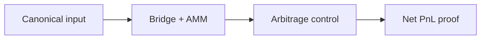

# SYNERGY 2Chain QE — научно-техническое досье V5

**Ревизия:** 24.10.2026 · **Партия:** репозитории SYNERGY №68–82 · **Фактический статус:** EXPERIMENTAL: Solidity и Foundry tests присутствуют; публичная прибыль не подтверждена.

> Исходники и наличие тестов проверены по дереву `main`. Это **документационный аудит**, не свидетельство свежего CI, успешного деплоя, воспроизводимого benchmark или экономической прибыли. Старый README сохранён.

## 1. Научная постановка

Исследовать, может ли последовательность bridge, AMM и контроллера реализовать положительный внешний canonical PnL без учёта self-induced valuation как дохода.

## 2. Реализация и исследовательская новизна

Контракты `BridgeCore`, `InternalAMM`, `ManagedOracle`, `ArbitrageExecutor`, `TreasuryDistributor`, синтетические USDS/ETHS. Есть adversarial/modeled тесты `ModelAuditTruth.t.sol`, `RealizedProfitFork.t.sol`, `ForeignDonorFork.t.sol`. Обязателен раздельный учёт внутрицепочечных переоценок и конечного canonical balance.

## 3. Математическая формализация

\[\mathrm{RealizedNetPnL}=\Delta\mathrm{CanonicalAssets}-\mathrm{ExternalDeposits}+\mathrm{Withdrawals}-\mathrm{Gas}-\mathrm{ExternalCosts}.\]
\[\mathrm{AMM}:x\,y=k;\qquad \mathrm{internal\ mint}\not\equiv\mathrm{external\ profit}.\]

Разграничение: формула, реализованная в исходном коде, может быть перепроверена статически; численные результаты и перенос на реальные данные требуют отдельного исполнения с артефактами и независимыми baseline.

## 4. Операционная цепочка



`architecture` описывает поток данных и проектное назначение; автоматически подтверждённой federated runtime-связи отсюда не следует.

## 5. Навигация по проверенным артефактам

- [`contracts/BridgeCore.sol`](../contracts/BridgeCore.sol)
- [`contracts/InternalAMM.sol`](../contracts/InternalAMM.sol)
- [`contracts/ArbitrageExecutor.sol`](../contracts/ArbitrageExecutor.sol)
- [`test/ModelAuditTruth.t.sol`](../test/ModelAuditTruth.t.sol)
- [`test/RealizedProfitFork.t.sol`](../test/RealizedProfitFork.t.sol)
- [`PROFIT_TEST_REPORT_2026-09-21.md`](../PROFIT_TEST_REPORT_2026-09-21.md)

## 6. Воспроизведение: доступная команда

```bash
forge test -vvv
forge test --match-path 'test/ModelAuditTruth.t.sol' -vvv
```

Команды приведены как **инструкция для самостоятельного запуска**, они не означают, что тесты были выполнены в рамках данной документационной ревизии.

## 7. Проверяемые гипотезы и acceptance gates

Проверить conservation canonical assets, withdrawability, oracle manipulation, HF/collateral guard, reentrancy, zero-external-edge negative control, replay одинакового fork block и sensitivity к газу/MEV.

**Граница доказательности:** `SOURCE_PRESENT` и `TEST_SOURCE_PRESENT` отличаются от `TEST_EXECUTED`, `INTEGRATION_VERIFIED`, `DEPLOYED` и `PRODUCTION_READY`. Для повышения статуса нужны command, environment, commit SHA, input manifest, raw output и критерий проверки.

## 8. Угрозы и отказоустойчивость

Уязвимости контрактов, oracle dependence, flash-loan dynamics, необеспеченный синтетический долг, price manipulation, bridging security.

## 9. Не доказано / ограничения

Fork-тест не равен реализованной транзакции на mainnet; профит на собственной внутренней кривой может обнуляться при выводе; обещание perpetual arbitrage некорректно без внешнего контрагента.

## 10. Следующий инженерный рубеж

Фиксировать exact fork block, RPC и deployment receipts, independent canonical-token snapshots before/after и аудиты контрактов до экономических заявлений.

## 11. Стандарт оформления и история

Досье ориентируется на практику [REVERSE-EXP](https://github.com/Shtenco/dlp_solver) и [SYNERGY SYSTEM](https://github.com/Shtenco/synergy_system): проверяемая постановка, формулы, ссылки на настоящий код, fidelity к реальному зрелости проекта и явные фальсифицирующие тесты. Исходный README и Git-история не удаляются. Четыре охраняемых README экосистемы остаются вне этой партии.
